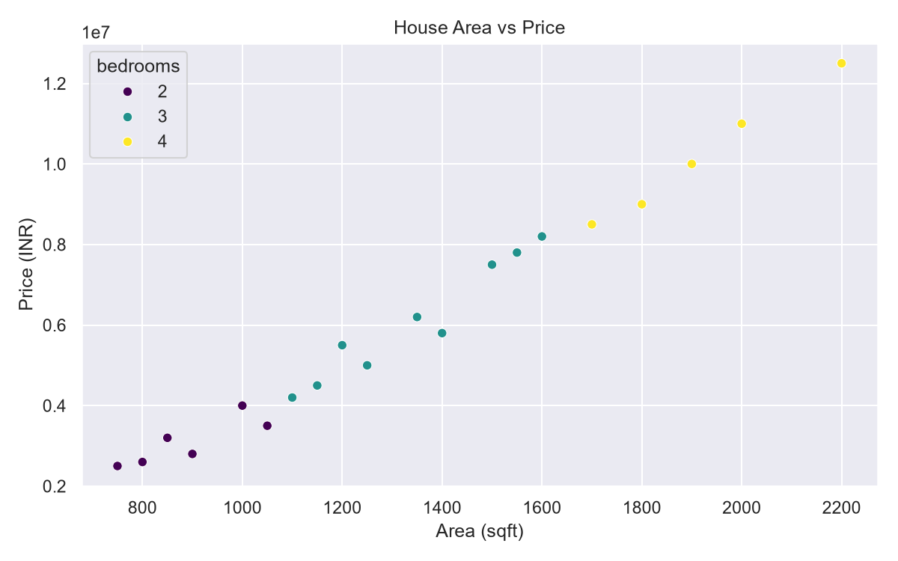
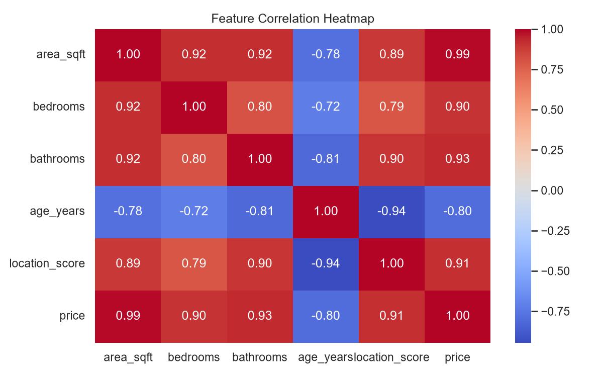

# House Price Prediction using Machine Learning

A beginner-friendly ML project using Linear Regression.

## Features
- House price prediction
- Model evaluation using MAE and R-squared
- Saved model using Joblib
- Data visualization using Matplotlib and Seaborn

## Tech Stack
- Python 3.11
- Pandas, NumPy, Scikit-learn
- Matplotlib, Seaborn, Joblib

## Run the Project

Install dependencies:
```bash
pip install pandas numpy scikit-learn matplotlib seaborn joblib
```

Run scripts:
```bash
python main.py
python save_model.py
python predict.py
python visualize.py
```

## Visualizations




## Dataset Disclaimer
The included dataset is synthetic sample data for educational purposes. Predictions are not real-world property valuations.

## Author
G. Vishnu Vardhan
GitHub: https://github.com/VishnuVardhan17-AI-ML
